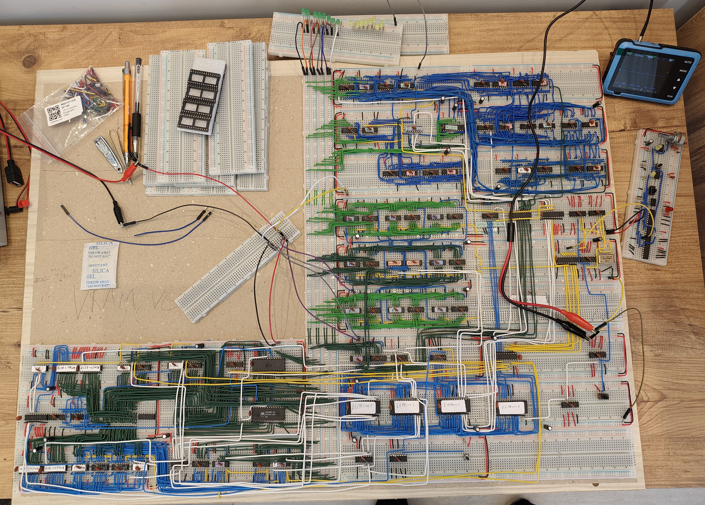
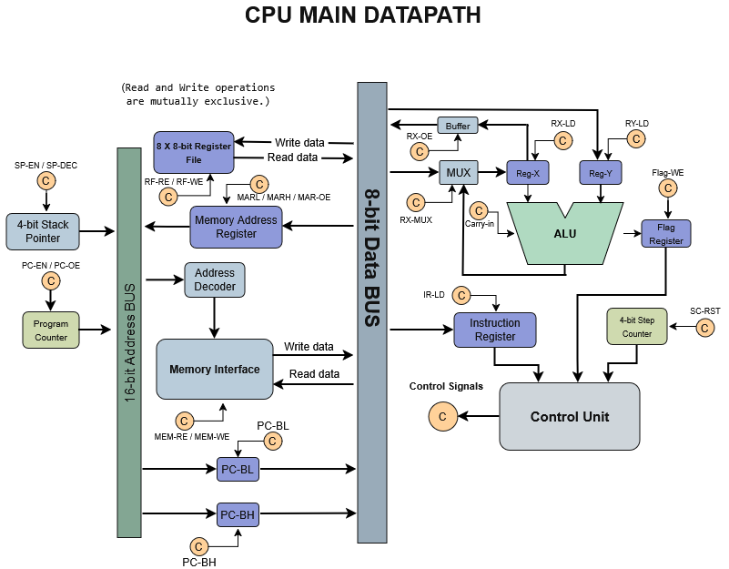
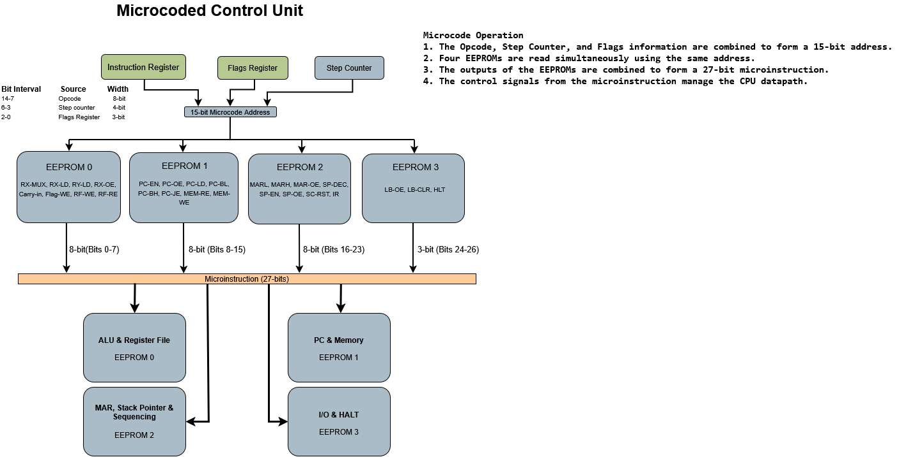
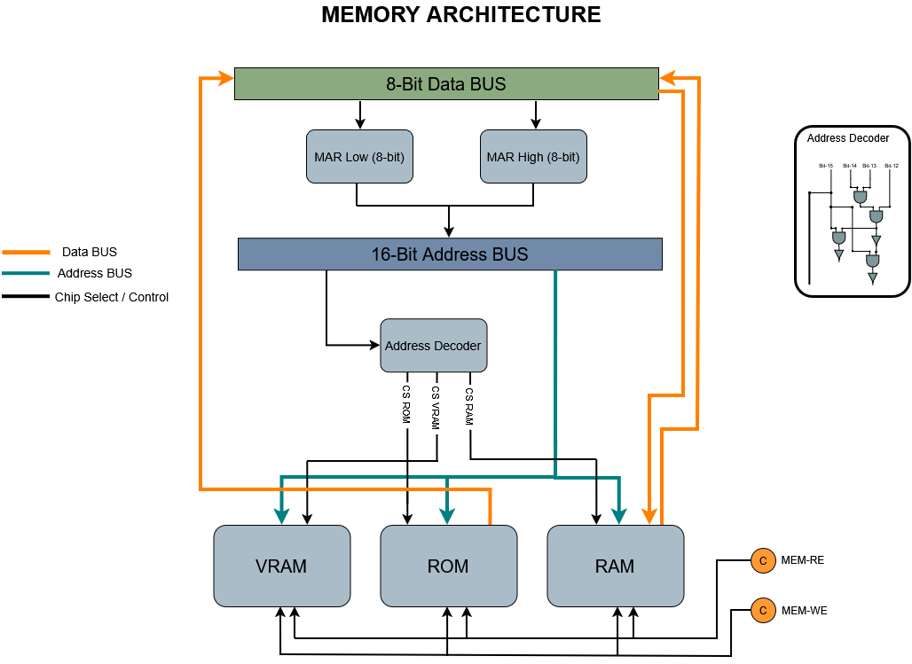
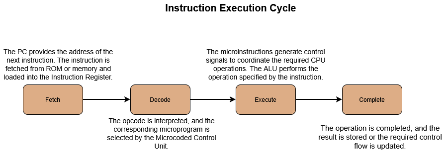

# Breadboard Computer

A fully custom 8-bit computer built from discrete 74HC-series logic ICs on solderless breadboards.

This project is a ground-up implementation of a computer system, including a custom instruction set, a microcoded control unit, a discrete-logic ALU, memory architecture, and software tools.

The goal is to build a functioning computer from individual logic components while making its internal architecture and operation physically observable.
<p align="center">
  
</p>

<p align="center">
  <em>A fully custom 8-bit computer built from 74HC-series logic ICs.</em>
</p>
## Project Video

[Watch the full project demonstration](https://youtu.be/oCEUKDI3oGM?si=TA5Yu-X200thrPix)

## Key Features

- Custom 8-bit CPU with a 16-bit address bus
- 64 KB address space
- Eight 8-bit general-purpose registers
- Dedicated ALU registers (`RX` and `RY`)
- Custom ALU implemented using adders, logic gates, and multiplexers
- EEPROM-based microcoded control unit
- 27 active control signals
- Variable-length instruction set (1-3 bytes)
- Stack pointer with `CALL` and `RET` support
- Memory-mapped ROM, SRAM, and VRAM
- VGA video output and PS/2 keyboard interface
- Custom Python assembler
- Python-based microcode generator
- Custom assembly programs

## Hardware

The computer is physically constructed using 74HC-series logic ICs mounted on multiple solderless breadboards.

The main hardware components include:

- Discrete logic circuits for the datapath and ALU
- Register and bus control circuits
- EEPROM-based microcode storage
- AT28C256 system ROM
- UT62256CPC-70LL SRAM and VRAM

The processor has been tested at clock frequencies of 1 Hz, 1 kHz, and 1 MHz, and has operated successfully at 1 MHz.

## Architecture Diagrams

The following diagrams illustrate the processor's internal datapath, microcoded control unit, memory organization, and instruction execution cycle.

### 1. CPU Datapath

Illustrates the processor's internal architecture, including the register file, ALU, internal registers, buses, and data transfer paths.



### 2. Control Unit Architecture

Shows the EEPROM-based microcoded control unit, its microinstruction organization, and the generation of control signals that coordinate the processor's operations.



### 3. Memory Architecture

Illustrates the computer's memory organization, including the System ROM, SRAM, VRAM, and memory address mapping.



### 4. Fetch–Decode–Execute Cycle

Shows the instruction execution process, from instruction fetching and decoding to execution through microcoded control sequences.



## Testing and Validation

The computer was tested through a series of hardware and software validation procedures.

- **Clock Frequency:** Successfully operated at 1 MHz, in addition to lower-frequency testing at 1 Hz and 1 kHz.
- **Instruction Execution:** Custom assembly programs were used to verify instruction execution and processor behavior.
- **Memory Operations:** Memory read and write operations were tested across the implemented memory regions.
- **Control Unit:** EEPROM-based microcode was tested to verify instruction sequencing and control signal generation.
- **Software:** The custom assembler and microcode generation tools were used to prepare programs and control instructions for the computer.

## Software Tools

The project includes custom software tools written in Python:

- **Assembler:** Translates programs written in the custom assembly language into machine code.
- **Microcode Generator:** Generates EEPROM-compatible microcode data from microinstruction definitions.

An assembly test program is also included in the repository.

## Repository Structure

```text
Breadboard-Computer/
├── README.md
├── docs/
│   ├── ISA.md
│   ├── architecture.md
│   ├── microarchitecture.md
│   ├── memory-map.md
│   └── hardware.md
└── src/
    ├── assembler/
    │   └── assembler.py
    ├── microcode/
    │   └── microcode_generator.py
    └── examples/
        └── test_program.asm
```

## Documentation

| Document | Description |
|---|---|
| [Architecture](docs/architecture.md) | Overall processor architecture |
| [ISA Reference](docs/ISA.md) | Instruction set and encoding |
| [Microarchitecture](docs/microarchitecture.md) | Microcoded control unit and execution |
| [Memory Map](docs/memory-map.md) | Memory address allocation |
| [Hardware](docs/hardware.md) | Physical hardware implementation |
| [Instruction Execution Walkthrough](docs/instruction-execution.md) | Step-by-step explanation of instruction encoding, microcode execution, and memory operations.|

## Future Development

Planned improvements include:

- Completing and refining the VGA and PS/2 interfaces
- Expanding software support and example programs
- Reimplementing the architecture in Verilog/SystemVerilog
- Porting the design to an FPGA platform

## License

License information will be added in a future update.